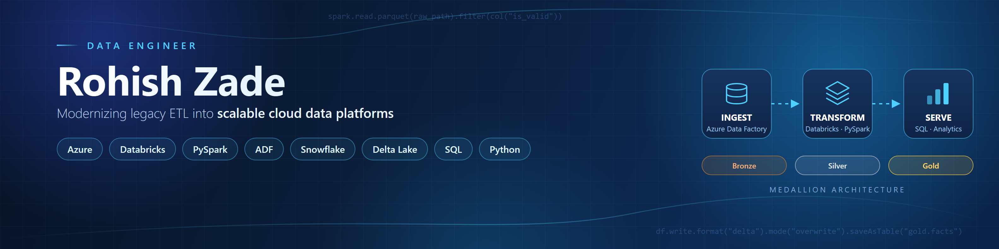

  

  
  
  
  

## Hi, I'm Rohish 👋

I'm a **Data Engineer with 5+ years of experience** designing, building, and optimizing large-scale ETL pipelines and cloud-native data platforms.

I specialize in **migrating legacy workloads (Hadoop, Hive, DataStage, Talend) to modern Azure + Databricks architectures**, with a focus on performance, data quality, and automation. I've delivered for clients in **banking & financial services** and **healthcare (claims, pricing & reimbursement)**.

- 💼 **Currently:** Data Engineer at **Next Pathway**, migrating DataStage ETL to Azure Databricks for a US healthcare client
- 🏦 **Previously:** Project Engineer at **Wipro**, building PySpark/ADF pipelines across 30+ source systems for a Tier-1 Canadian bank
- 🎓 **Education:** B.E. in Computer Science & Engineering
- ✍️ **Writing:** Data engineering notes on [Substack](https://substack.com/@rohishzade)
- 📍 **Location:** Pune, India

---

## 🛠️ Tech Stack

**Languages**

**Big Data & Processing**

**Cloud & Platforms**

**Tools & Practices**

---

## 🚀 What I Do

| Area | Highlights |
|---|---|
| **Legacy → Cloud Migration** | Migrated DataStage, Hadoop, Hive & Talend workloads to Databricks + ADF while preserving data integrity and business logic |
| **ETL / ELT Pipelines** | Built scalable PySpark pipelines across **30+ source systems** using Databricks and ADF |
| **Performance Tuning** | Optimized joins, partitioning, and caching in Spark - **~30% faster job execution** |
| **Automation** | Python-based pre-deployment validation that cut **deployment effort by 70%** and **integration issues by 40%** |
| **Data Quality** | Built an automated reconciliation & validation tool, **reducing manual effort by 70%** |
| **Reusable Frameworks** | Shared PySpark UDFs, utility modules, and Databricks notebook templates to accelerate migrations |

---

## 📜 Certifications

-Certified-0078D4?style=flat-square)
-Certified-0078D4?style=flat-square)

---

## 📂 Featured Repositories

| Repository | Description |
|---|---|
| [PySpark](https://github.com/rohish-zade/PySpark) | Hands-on PySpark notes and notebooks - transformations, joins, window functions, optimization |
| [SQL](https://github.com/rohish-zade/SQL) | Solutions to the SQL 50 study plan |
| [data-warehousing](https://github.com/rohish-zade/data-warehousing) | Data warehousing concepts - dimensional modeling, SCDs, star/snowflake schemas |
| [Big-Data-Interview-Preparation](https://github.com/rohish-zade/Big-Data-Interview-Preparation) | Curated big data & data engineering interview questions |
| [Python](https://github.com/rohish-zade/Python) | Python fundamentals and learning notes |

---

## 🤝 Let's Connect

I'm always happy to talk about **data engineering, Spark performance, cloud migrations, and Databricks**.
Feel free to reach out on [LinkedIn](https://www.linkedin.com/in/rohish-zade-0094b81a0) or by [email](mailto:zaderohish5@gmail.com).
